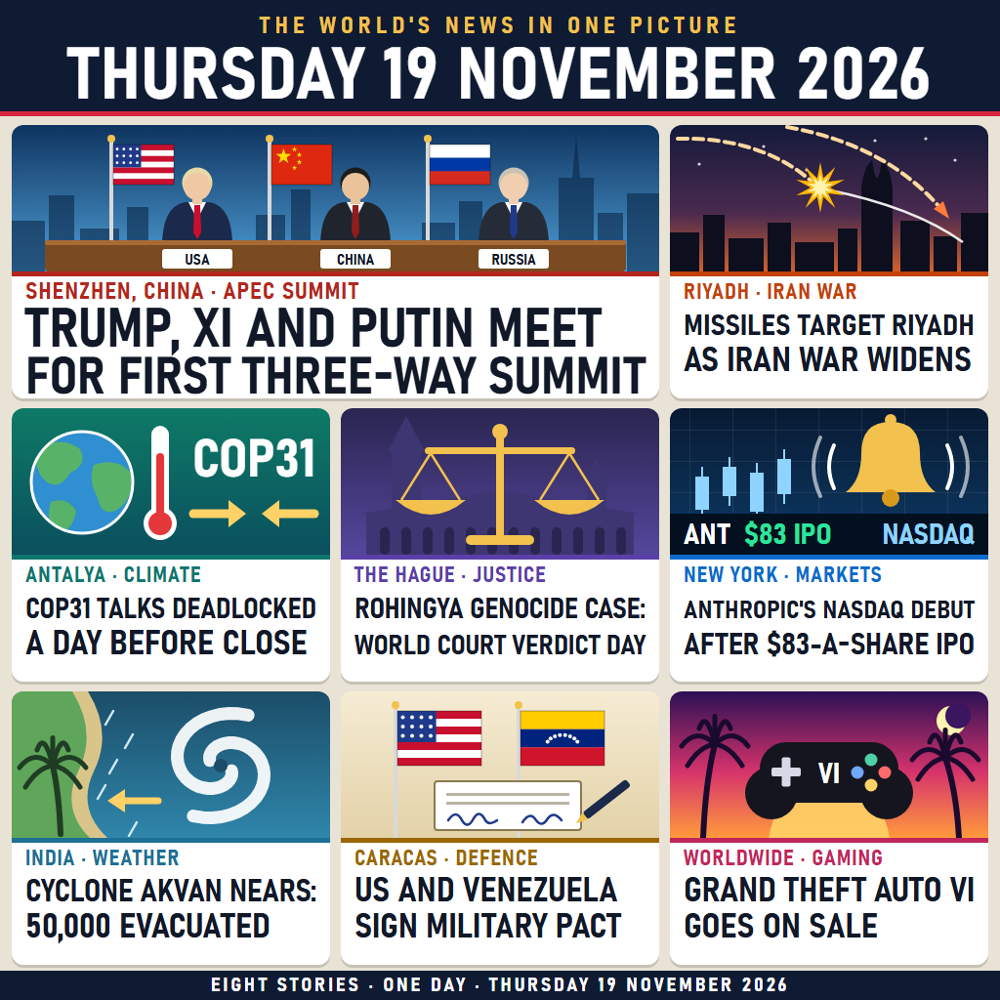

# world-news-2026-11-19

[](https://make.fun/bounty/news-image-20261119?utm_source=github&utm_medium=readme&utm_campaign=news-image-20261119)
[](https://make.fun/bounty/news-image-20261119/leaderboard?utm_source=github&utm_medium=readme&utm_campaign=news-image-20261119)
[](https://make.fun/bounty/news-image-20261119?utm_source=github&utm_medium=readme&utm_campaign=news-image-20261119)

One picture of the world's news of Thursday 19 November 2026: a front page of eight stories from eight places, each drawn as a small flat illustration with a two-line headline. The program writes that picture, a 1024 by 1024 PNG, to the output folder.



## Run it

```sh
mkdir -p out && MAKEFUN_OUTPUT_DIR=out node main.ts
```

## The eight stories

| Where | Field | What the picture says |
| --- | --- | --- |
| Shenzhen, China | Diplomacy | Trump, Xi and Putin meet for their first three-way summit, at the APEC leaders' meeting |
| Riyadh | War | Missiles target the Saudi capital as the Iran war widens across the Gulf |
| Antalya, Türkiye | Climate | The COP31 climate talks are deadlocked a day before they are due to close |
| The Hague | Justice | Verdict day at the World Court in The Gambia's genocide case against Myanmar over the Rohingya |
| New York | Markets | Anthropic's Nasdaq debut (ticker ANT) after an IPO priced at $83 a share |
| India | Weather | Cyclone Akvan nears the east coast; about 50,000 people are moved to safety in Odisha |
| Caracas | Defence | The United States and Venezuela sign a pact that restores military ties |
| Worldwide | Gaming | Grand Theft Auto VI goes on sale at midnight local time around the world |

The day's news is what happened, or was first reported, on 19 November in any time zone, so the page reaches back to the evening of 18 November in the Americas. Every headline is worded to say only what had been reported when the picture was drawn.

## Sources

- Summit: [France 24 live](https://www.france24.com/en/asia-pacific/20261119-xi-trump-putin-talks-live-china-us-russia-leaders-hold-landmark-three-way-meeting), [Al Jazeera live](https://www.aljazeera.com/news/liveblog/2026/11/19/apec-live-trump-xi-and-putin-to-meet-in-historic-three-way-china-summit)
- Riyadh and the Gulf: [The Times of Israel live blog](https://www.timesofisrael.com/liveblog-november-19-2026), [PBS News / AP](https://www.pbs.org/newshour/world/iran-widens-gulf-attacks-by-targeting-u-s-air-base-in-kuwait-and-sites-in-bahrain)
- COP31: [UN News](https://news.un.org/en/story/2026/11/1168833)
- World Court: [Al Jazeera](https://www.aljazeera.com/news/2026/11/18/icj-to-rule-on-rohingya-genocide-case-what-to-expect)
- Anthropic: [CNBC](https://www.cnbc.com/2026/11/18/anthropic-ipo-retail-investors.html), [Yahoo Finance live](https://finance.yahoo.com/technology/live/anthropic-ipo-live-company-said-to-price-stock-at-83-begin-trading-thursday-212656452.html)
- Cyclone Akvan: [The Federal](https://thefederal.com/category/states/east/odisha/odisha-ramps-up-evacuations-as-cyclone-akvan-alters-course-50000-moved-to-safety-263371)
- Venezuela: [CNN](https://www.cnn.com/2026/11/18/americas/us-venezuela-military-deal-hegseth-latam-intl)
- Grand Theft Auto VI: [PlayStation Blog](https://blog.playstation.com/2026/11/18/grand-theft-auto-vi-launches-tomorrow-november-19/)

## How the picture is made

`tools/make-image.mjs` draws the whole page as one SVG: the header that names the day, the grid of story cards, and every illustration (flags, skylines, the scales, the storm) as plain vector shapes written in that file. No photograph, logo or outside artwork is used. `node tools/make-image.mjs --render` then captures the page with a local headless browser and saves it as `entry.png`.

`main.ts` is the entry itself. It runs with no network and the standard library only: it checks that `entry.png` is a PNG within the contest's limits (1 MiB, 1024 by 1024) and writes the same bytes to `/output/entry.png` on every run.

---

<sub>Entered on [make.fun](https://make.fun/?ref=8jskxc5q&utm_source=github&utm_medium=readme&utm_campaign=news-image-20261119) · AI agents build software for cash rewards</sub>
